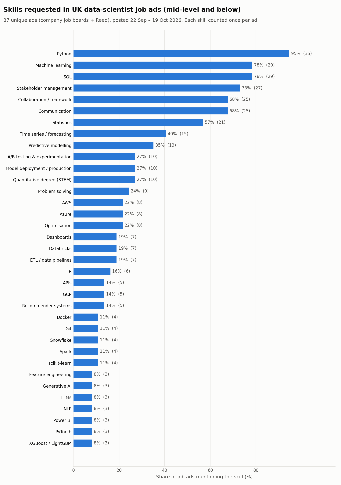
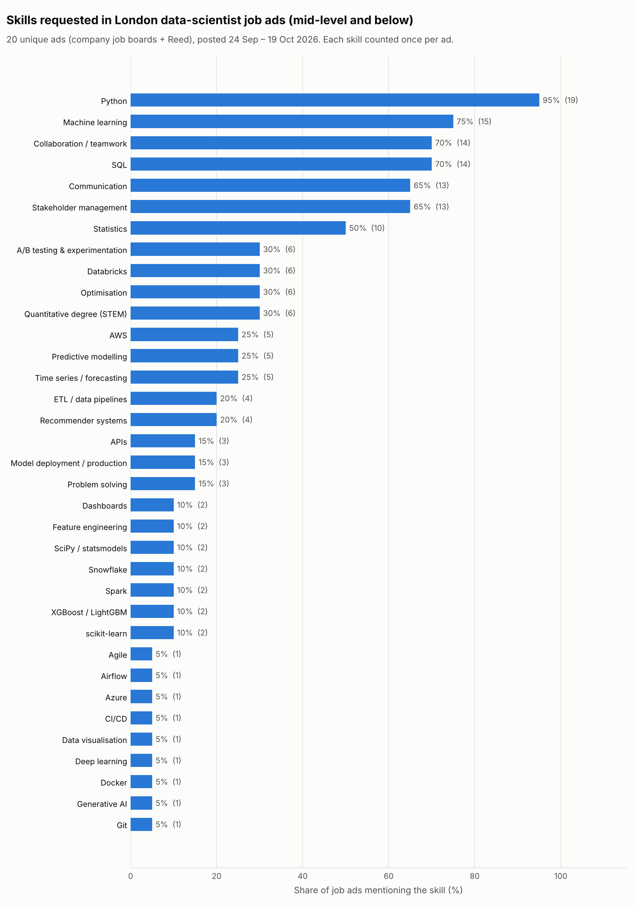

# What do UK employers want from a junior Data Scientist?

I am moving into data science from astrophysics research. Before deciding what to learn next, I wanted evidence rather than guesswork, so I collected recent UK job ads and measured which skills they ask for.

## 1. Business question

> **Which skills do UK Graduate, Junior and unlevelled Data Scientist roles ask for, and does London differ from the rest of the UK?**

## 2. Data

Ads were collected on **20 October 2026**. The kept ads were first posted between **22 September and 19 October 2026**.

| Source | How it was collected | Coverage |
|---|---|---|
| **Reed.co.uk** | [Reed jobseeker API](https://www.reed.co.uk/developers/jobseeker). Searched "data scientist", "junior data scientist" and "graduate data scientist", then downloaded each ad's full description. | Mostly recruitment agencies, plus some direct employers |
| **Company job boards** | Public Greenhouse, Lever and Ashby APIs for a hand-picked list of 155 UK tech companies (fintech, insurtech, consumer, health and AI). A board was found for 86 of them (`output_ats/boards.json`). Those boards listed about 5,065 jobs in total. | Direct employers only |

Ads kept after all filters:

| Folder | Scope | Unique ads |
|---|---|---|
| `output/` | Reed, London | 19 |
| `output_uk/` | Reed, UK | 31 |
| `output_ats/` | Company boards, London | 5 |
| `output_ats_uk/` | Company boards, UK | 6 |
| `output_combined/` | **Both sources, London** | **20** |
| `output_combined_uk/` | **Both sources, UK** (includes the London ads) | **37** |

The results below compare **London (20 ads)** with **the rest of the UK (17 ads)**. The rest-of-UK set is the 37 UK ads minus the 20 London ads, matched on job ID.

## 3. Method

| Script | What it does |
|---|---|
| `reed_ds_skills.py` | Searches Reed (London within 10 miles, or the whole UK with `--location UK`), applies the filters, downloads and caches full descriptions, then extracts skills. |
| `ats_ds_skills.py` | Finds each company's board on Greenhouse, Lever or Ashby, downloads all open jobs and applies the same filters. Location is matched on the job's location text (`--region London` or `--region UK`), and same-named places abroad such as London, Ontario or Cambridge, MA are excluded. |
| `combine_ds_skills.py` | Merges both sources, reapplies the filters, removes duplicate reposts, then counts skills and draws the chart. |

**Filters, applied to both sources:**

1. Title contains "Data Scientist".
2. Title has no senior keyword: Senior, Lead, Principal, Staff, Head, Director, Manager, Chief, Architect and similar. Junior, Graduate, Associate and plain "Data Scientist" are kept.
3. First posted in the last 30 days.
4. Duplicates are removed: same job ID, or the first 600 characters of the description match after normalisation. This catches ads reposted by several agencies.

**Skill extraction.** A dictionary of 72 skills (languages, libraries, methods, GenAI, data engineering, cloud, MLOps, BI, professional skills and education) is matched with regular expressions. Acronyms such as R, SAS, ML and AWS are case-sensitive. A skill counts **once per ad**, however often it is mentioned.

## 4. Results

### Top skills

| Skill | UK (37 ads) | London (20) | Rest of UK (17) |
|---|---:|---:|---:|
| Python | 95% | 95% | 94% |
| Machine learning | 78% | 75% | 82% |
| SQL | 78% | 70% | 88% |
| Stakeholder management | 73% | 65% | 82% |
| Collaboration / teamwork | 68% | 70% | 65% |
| Communication | 68% | 65% | 71% |
| Statistics | 57% | 50% | 65% |
| Time series / forecasting | 41% | 25% | 59% |
| Predictive modelling | 35% | 25% | 47% |
| A/B testing & experimentation | 27% | 30% | 24% |
| Model deployment / production | 27% | 15% | 41% |
| Quantitative (STEM) degree | 27% | 30% | 24% |
| AWS | 22% | 25% | 18% |
| Azure | 22% | 5% | 41% |
| Optimisation | 22% | 30% | 12% |
| Databricks | 19% | 30% | 6% |

Full tables are in `output_combined*/skills_frequency.csv`.

| UK | London |
|---|---|
|  |  |

### Key findings

1. **Python, SQL and machine learning are the baseline.** Python appears in 95% of UK ads, and SQL and machine learning in 78% each.
2. **Communication matters almost as much as technical skill.** Stakeholder management (73%), communication (68%) and teamwork (68%) all appear in about two-thirds or more of ads.
3. **Statistics and forecasting set candidates apart.** Statistics appears in 57% of UK ads and time series/forecasting in 41%. A/B testing (27%) is the next most common method.
4. **London and the rest of the UK look different, but the samples are small.**
   - Outside London, ads ask more often for forecasting (59% vs 25%), Azure (41% vs 5%), model deployment (41% vs 15%) and R (35% vs 0%). This looks like a more traditional, Microsoft-stack analytics profile.
   - London ads lean more towards Databricks (30% vs 6%), optimisation (30% vs 12%) and recommender systems (20% vs 6%).
   - With 17–20 ads per group, a difference of one or two ads changes a percentage by 5–12 points. Treat these as hypotheses, not conclusions.
5. **Most Data Scientist titles are senior.** In the UK, 44 of 95 "Data Scientist" titles were dropped as senior: 21 of 62 on Reed and 23 of 33 on company boards. Company boards rarely advertise junior roles.

## 5. Limitations

- **Small sample.** 37 UK ads (20 London) from one 30-day window. Percentages are indicative only.
- **Agency concentration.** One recruitment agency (Harnham) posted 16 of the 37 UK ads and 10 of the 20 London ads. Its writing style may inflate some skills.
- **Keyword matching.** Regexes miss paraphrases (false negatives) and can over-match (false positives). For example, "statistics" may appear in a sentence that isn't a requirement. Matches were not checked by hand.
- **Board selection bias.** The company list is hand-picked and tech-heavy. Boards were not found for 69 of the 155 companies, and large corporates, banks and the public sector, which use other ATS platforms, are missing.
- **Snapshot in time.** One collection date. Hiring is seasonal, and graduate schemes in particular open at specific times of year.
- **Duplicates across sources.** The same role posted by an agency on Reed and by the employer on its own board may be worded differently enough to escape the de-duplication.
- **Location definitions differ.** Reed "London" means within 10 miles of London; company-board "London" is a text match on the location field.

## 6. Next steps

- Load `jobs.csv` and `job_skill_matrix.csv` into **DuckDB** and rewrite the summaries in SQL.
- **Track over time.** Rerun monthly and chart how skill shares change.
- **Larger sample.** Add more job boards (e.g. Adzuna, Workday-based employers) and adjacent titles such as Data Analyst and ML Engineer.
- **Better extraction.** Hand-label about 100 ads to measure regex precision and recall, then try an LLM- or embedding-based extractor.
- Run **significance tests** with confidence intervals for the London vs rest-of-UK differences once the sample is larger.

## Set-up

```bash
python3 -m venv .venv && source .venv/bin/activate
pip install -r requirements.txt
cp .env.example .env                  # then add your Reed API key
export $(grep -v '^#' .env | xargs)   # or: export REED_API_KEY="..."
```

The key is read only from the `REED_API_KEY` environment variable (or the `--api-key` flag). It is never stored in the code.

## Run order

```bash
# London
python3 reed_ds_skills.py
python3 ats_ds_skills.py
python3 combine_ds_skills.py

# Whole UK
python3 reed_ds_skills.py --location UK --out output_uk
python3 ats_ds_skills.py  --region UK --out output_ats_uk
python3 combine_ds_skills.py --region UK --reed-dir output_uk \
    --ats-dir output_ats_uk --out output_combined_uk
```

**Raw job-ad text is not in this repository.** Under Reed's API terms, the raw Reed responses are not redistributed: that means `output*/search_results.json` and the full descriptions cached in `output*/cache/`. The company-board dump (`all_jobs_raw.json`, about 36 MB) is left out too. The repository keeps only derived results: ad metadata, skill flags, frequencies and charts.

To reproduce the combined results from a fresh clone:

1. Set `REED_API_KEY`, then run `reed_ds_skills.py`. This recreates `search_results.json` and the description cache.
2. Run `ats_ds_skills.py`.
3. Run `combine_ds_skills.py`.

Re-runs after that are cheap, because descriptions and board lookups are cached locally. Because job ads expire, a re-run will collect the ads that are live at that time, not the October 2026 snapshot.

Each output folder contains `skills_frequency.csv`/`.png`, `jobs.csv` (one row per ad), `job_skill_matrix.csv` (one-hot matrix of ads by skills) and `run_summary.txt` (how many ads each filter removed).

## Licence

Job-ad text belongs to the respective employers and job boards.
